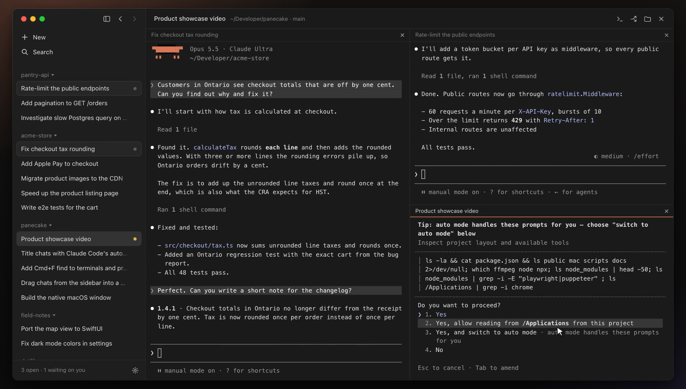

# Claude Deck

A macOS desktop app around the real Claude Code CLI: every chat you've had in a
sidebar, several chats side by side in a grid, and terminals next to them.

> **Unofficial.** Claude Deck is a community project. It is not made by, affiliated
> with or endorsed by Anthropic.



https://github.com/user-attachments/assets/1df122a0-8cf2-482b-baef-7b7aacd94583

## Why I needed it

Claude Code in a terminal is fast and light, but once you run many chats across projects, terminal tabs stop scaling. You can't easily see which chats are working, finished or waiting on you, or where last week's chat lives, and a closed chat has to be found again with /resume. IDEs and the Claude desktop app solve that, but bring far more than I needed, and in my use the desktop app's chats started with more of the context window already used than the plain CLI.

Deck adds only the missing layer around the plain CLI: a sidebar, a grid, status and search. It adds nothing to your chats. Each one gets exactly the context Claude Code itself loads.

## Why it is built this way

Each chat is the unmodified `claude` binary running in an embedded terminal. Deck
does not reimplement the chat UI, so everything Claude Code does still works:
slash commands, `/config`, pickers, permission prompts, the status line and your
settings. When Claude Code updates, Deck gets the update for free.

## Features

- **Every chat in one sidebar.** Grouped by project and sorted by recent activity,
  with Claude Code's own automatic titles. Rename or hide chats without touching
  Claude Code's files.
- **Live status.** A spinner means a chat is working; an amber dot means it is
  waiting on you, for example at a permission prompt.
- **Search (⌘K).** Searches titles and the text inside chats. Open any result to
  resume it where it left off.
- **Grid.** Drag chats from the sidebar onto any edge of a pane to split it.
- **Terminals (⌘J).** A shell in the active chat's folder. Running programs get a
  green dot in the sidebar.
- **⌘-click.** Paths and links in any terminal: folders and files show in Finder
  (nothing is launched), web links open in the browser, and `.md` files open in a
  sanitized preview pane.
- **Find (⌘F).** In terminals, chats and Markdown previews.
- **Keyboards beyond US layouts.** Option types characters such as `@` and `#` by
  default; a setting makes it act as Alt instead.

## Requirements

- macOS
- [Claude Code](https://code.claude.com/docs) installed and signed in
- Node.js 20.11 or newer
- Xcode Command Line Tools (`xcode-select --install`), to build the native window

## Install

```sh
git clone https://github.com/saidbilal/claude-deck.git
cd claude-deck
npm run build
```

This installs dependencies and builds `~/Applications/Claude Deck.app`. The app
runs the server from this folder, so keep the folder where it is; if you move it,
run `npm run build` again. macOS may ask whether Terminal can modify apps.

To run only the server and use your browser instead, run `npm start` and open the
URL it prints.

## Shortcuts

| Keys | Action |
| --- | --- |
| ⌘N | New chat |
| ⌘J | New terminal in the active folder |
| ⌘K | Search chats |
| ⌘F | Find in the active pane |
| ⌘B | Show or hide the sidebar |
| ⌘⌥↑ / ⌘⌥↓ | Previous or next chat in the sidebar |
| ⌘⌥← / ⌘⌥→ | Move between panes |
| ⌘[ / ⌘] | Back or forward through what you opened |
| ⌘-click | Open a path or link from a terminal |

## Privacy and security

- **Read-only on Claude Code's data.** Deck reads `~/.claude` (and Claude
  Desktop's session list, if present) but never writes to them. Renames, hidden
  chats and preferences live in `~/Library/Application Support/Claude Deck/`.
- **Local only.** The server listens on `127.0.0.1`, requires a token created at
  each launch, and checks the Host and WebSocket Origin headers, because it can type
  into shells.
- **Clicks never launch anything.** ⌘-click on a file selects it in Finder instead
  of opening it, including app bundles.
- **No network requests from previews.** Markdown is sanitized with DOMPurify, and
  remote images are shown as links.

## How it works

| Part | Job |
| --- | --- |
| `server.mjs` | Indexes Claude Code's transcripts, runs `claude` and shells in pseudo-terminals (node-pty), serves the UI |
| `public/` | Sidebar, grid and xterm.js terminals, with no framework |
| `mac/main.swift` | Native window (WKWebView); starts and stops the server |

`CLAUDE.md` explains the design decisions and the behavior that looks odd but is
deliberate. This project was built with Claude Code, and that file is what keeps
its sessions on track.

## Contributing

This is a hobby project maintained by one person. Bug reports and ideas are
welcome as issues. Pull requests are welcome too, though I may not be able to
review every one quickly. If you change dependencies, run `npm audit`: the
Markdown sanitizer is a security boundary.

## License

[MIT](LICENSE)
